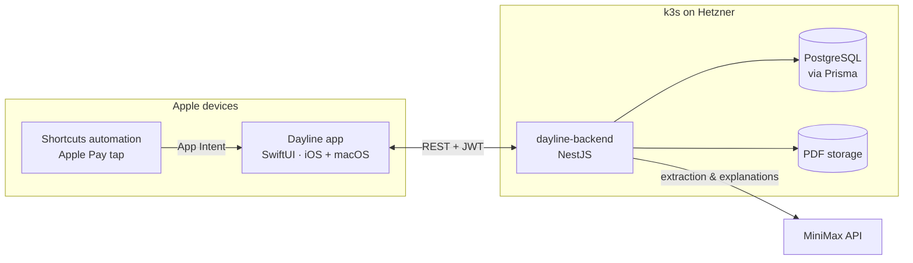

<div align="center">

# Dayline

**One number a day. Salary to salary.**

A personal budgeting app for iPhone and Mac that turns your pay period into a single daily spending limit, recovers automatically when you overspend, and keeps your savings goals out of reach of bad decisions.


</div>

---

## Why

Monthly budgets don't match how salary works. Payday moves (the 1st, or the Friday before if it's a weekend, or sometimes the Monday after), bills come out at different times, and a "monthly" overview tells you nothing about whether you can afford lunch **today**.

Dayline answers one question: **how much can I spend today and still be fine until the next salary?**

## How the daily limit works

```
free money   = salary − fixed bills − monthly savings contributions
daily limit  = free money ÷ days until next payday
```

Spend less than the limit → the difference goes to savings.
Spend more → the extra is paid back over the next few days, then the limit returns to normal.

**Example**: daily limit 26 ₾, you spend 35 ₾ on day 10 (9 ₾ over), recovery window 3 days:

| Day | Limit | Spent | Overspend left |
|---|---|---|---|
| 10 | 26.00 | 35.00 | 9.00 ⚠️ |
| 11 | 23.00 | 23.00 | 6.00 |
| 12 | 23.00 | 23.00 | 3.00 |
| 13 | 23.00 | 23.00 | 0.00 ✅ |
| 14 | **26.00** | back to normal | |

Under-spending always repays an open overspend first; only then does it count as savings.

## Features

| | Feature | Status |
|---|---|---|
| 📅 | **Variable payday.** The app predicts the next salary date and asks *"Did your salary arrive?"*; the period and daily limit adjust to the real date | Planned |
| 🎯 | **Daily limit engine** with overspend recovery (1–7 days or rest of period) | Planned |
| ⚡ | **Fast expense entry.** Amount first, category chips, under 5 seconds | Planned |
| 💳 | **Apple Pay capture.** A Shortcuts automation logs each tap-to-pay purchase; a notification asks *Paid / Declined* | Planned |
| 📥 | **Payment inbox.** Apple Pay, bank SMS and statement imports land in one review queue with suggested categories, deduplicated | Planned |
| ✅ | **Bills checklist.** Rent, loans, subscriptions and debts per pay period: due / paid / overdue | Planned |
| 🧳 | **Stash boxes.** Custom savings goals, typed *Travel* (spend by a date) or *Saving* (protected) | Planned |
| 🏦 | **Loans.** Upload a loan PDF, AI extracts the terms and schedule, duplicate uploads are detected | Planned |
| 🤖 | **Repayment advisor.** Suggests extra loan payments only from money no trip or protected goal needs. The math is done by the backend; the AI only explains it | Planned |
| 🖥️ | **iPhone + Mac.** One SwiftUI codebase, offline entry, sync | Planned |

## Architecture



## Tech stack

| Layer | Technology |
|---|---|
| App | SwiftUI multiplatform (iOS 17+, macOS 14+), SwiftData cache, App Intents, XcodeGen |
| Backend | NestJS (TypeScript), Prisma ORM |
| Database | PostgreSQL (money as `Decimal`, never floats) |
| AI | MiniMax API (loan/statement PDF extraction, recommendation text) |
| Infra | k3s (Kubernetes) on Hetzner, Traefik ingress, cert-manager |

## Repository layout

This is the parent repo. The app and backend are git submodules.

```
.
├── dayline-app/        # SwiftUI app (iOS + macOS)
├── dayline-backend/    # NestJS API
└── docs/
    ├── requirements.md # full product spec & data model
    └── design-prompt.md
```

## Getting started

### Prerequisites

- macOS with **Xcode 16+**
- **Node.js 20+** and npm
- **XcodeGen**: `brew install xcodegen`
- PostgreSQL 16+ (local or Docker), once the database lands

### Clone

```sh
git clone --recurse-submodules https://github.com/J1NCH0/Dayline.git
cd Dayline
# already cloned without submodules?
git submodule update --init --recursive
```

### Backend

```sh
cd dayline-backend
npm install
npm run start:dev       # http://localhost:3000
npm test
```

### App

```sh
cd dayline-app
xcodegen generate       # regenerate after editing project.yml
open Dayline.xcodeproj
```

Select your team under **Signing & Capabilities**, then run on an iPhone simulator or *My Mac*.

## Roadmap

- [ ] **M1 · Core budget:** pay periods with variable payday, expenses, daily limit + recovery, Today screen, k3s deploy
- [ ] **M2 · Bills & debts:** per-period checklist, balances that go down as you pay
- [ ] **M3 · Stash boxes:** travel and saving goals with projections
- [ ] **M4 · Capture inbox:** Apple Pay App Intent + confirm notification, bank SMS, merchant rules
- [ ] **M5 · AI documents:** loan PDF extraction + dedup, statement import
- [ ] **M6 · Repayment advisor**
- [ ] **M7 · Polish:** macOS layout, history & charts

Details for every milestone are in [`docs/requirements.md`](docs/requirements.md).

## Contributing

Dayline is a personal project built in the open. Issues and ideas are welcome. For larger changes, open an issue first so we can talk it through.

## License

[MIT](LICENSE)
